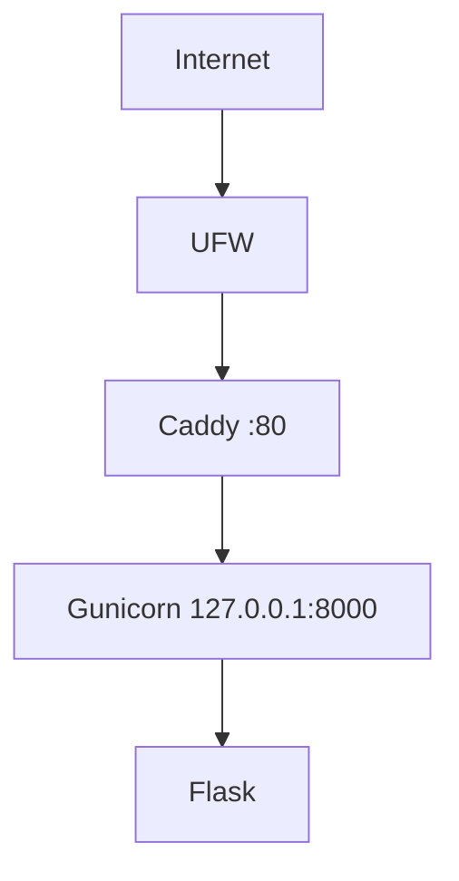

# Architecture v0.1

## Deployment View

## Resource Constraints
- 1 vCPU
- 1 GB RAM
- 20 GB disk

## Security Decisions
- non-root administration
- SSH key authentication
- password SSH disabled
- UFW enabled
- backend loopback-only
- AWS Security Group: SSH (22) dibatasi ke alamat IP klien, HTTP (80) terbuka untuk publik

## Current Limitations
- HTTP only
- single VPS
- no database
- no container
- no CI/CD

## Planned Evolution
- M04 DNS + HTTPS
- M05 persistent data
- M06 container
- M07 IaC
- M09 CI/CD

## Implementation Note (AWS EC2)
- Penyedia: AWS EC2, region ap-southeast-1 (zona ap-southeast-1a), tipe t3.micro.
- Batas 1 vCPU dipenuhi dengan CPU options CoreCount=1 dan ThreadsPerCore=1, karena akun hanya dapat memakai tipe free-tier yang bawaannya 2 vCPU.
- Disk: volume EBS gp3 20 GB, tidak terenkripsi.
- Swap 1 GB (opsional modul, bagian 36) aktif sebagai buffer.
- Status: kesetaraan EC2 dengan "VPS" pada modul belum dikonfirmasi dosen.
- Observasi (non-fatal): saat dijalankan lewat systemd, Gunicorn mencatat `Control server error: [Errno 13] Permission denied: '/home/cloudstudent'` karena `ProtectHome=true` pada unit file modul menutup akses ke folder home. Aplikasi dan /health tetap normal; unit file tidak diubah.
